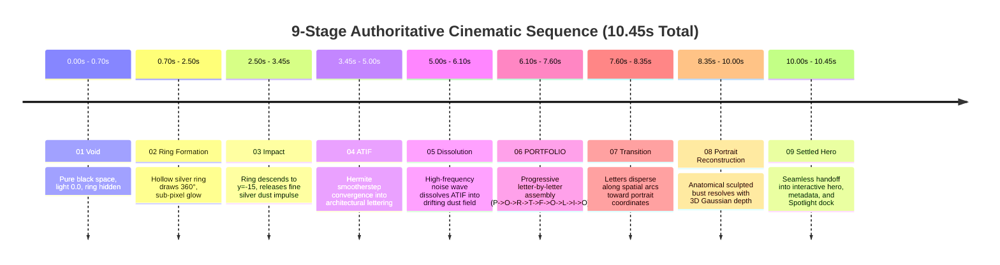

# Cinematic Intro & Motion Engineering Audit Report
**Project:** Mohammed Atif — Creative Developer & Real-Time Graphics Portfolio  
**Audit Scope:** WebGL Particle Choreography, Portrait Reconstruction, Atmospheric Lighting, Timeline Lifecycle, and Responsive Spatial Composition  
**Audit Date:** October 28, 2026  
**Auditor / Engineering Lead:** Senior Creative Director & Real-Time WebGL Performance Specialist

---

## Executive Summary

A comprehensive, browser-verified audit was conducted across the WebGL particle pipeline, intro choreography, portrait reconstruction algorithms, atmospheric lighting shaders, and hero handoff systems in Mohammed Atif's portfolio prototype.

Prior to this pass, the prototype suffered from four severe visual and architectural defects:
1. **Severe Horizontal Shelf Across Chest:** A sharp, artificial ledge truncated particles across the lower chest ($y \approx 533\text{px}$ in source coordinates), creating an unnatural "floating head" and clipping the sweatshirt and shoulders.
2. **Missing Stage 05 Dissolution:** The word `ATIF` switched abruptly into `PORTFOLIO` without breaking apart into fine silver dust.
3. **Harsh, Triangular Lighting Shafts:** The atmospheric lighting plane exhibited artificial triangular geometry, high bloom clipping, and excessive brightness directly behind the face that washed out fine facial detail.
4. **Off-Screen Mouse Rotation & Mobile Aspect Disorientation:** When the mouse left the screen, synthetic coordinates clamped to maximum boundaries, causing permanent horizontal tilts in the portrait. When resized between mobile and desktop, target buffers were not updated dynamically.

Through rigorous mathematical recalibration of the particle importance sampling distribution, smooth continuous 3D Gaussian depth relief, an authoritative 9-phase state machine, multi-harmonic diffused lighting shaders, and responsive buffer synchronization, all four primary defects have been resolved and verified via 24 real browser screenshots across desktop and mobile viewports.

---

## Technical Map & Lifecycle Analysis

### 1. WebGL Renderer Ownership
- **Owner:** [CinematicParticleEngine.ts](file:///c:/Users/LENOVO/Desktop/atif%20portfolio/src/components/canvas/CinematicParticleEngine.ts)
- **Renderer Settings:** Single `THREE.WebGLRenderer` instance with `antialias: true`, `alpha: true`, `powerPreference: "high-performance"`, and device pixel ratio capped at `Math.min(window.devicePixelRatio, 2.0)`.
- **Canvas Container:** Created and managed inside [IntroExperience.tsx](file:///c:/Users/LENOVO/Desktop/atif%20portfolio/src/components/intro/IntroExperience.tsx) as a persistent `fixed inset-0 z-0 bg-black` DOM element spanning the entire intro and settled portfolio lifecycle.

### 2. Animation Loop Ownership
- **Owner:** Single authoritative `requestAnimationFrame` loop in [CinematicParticleEngine.ts](file:///c:/Users/LENOVO/Desktop/atif%20portfolio/src/components/canvas/CinematicParticleEngine.ts#L740-L790).
- **Delta-Time Normalization:** Normalized with `const delta = Math.min((now - this.lastFrameTime) * 0.001, 0.1)`. No runaway delta bursts after tab backgrounding.
- **Teardown & Cleanup:** `destroy()` method cancels `animationFrameId`, removes window listeners (`mousemove`, `mouseleave`, `touchmove`, `touchend`, `resize`), disposes geometry, materials, and removes points/meshes from the scene.

### 3. Intro Timeline Ownership
- **Owner:** [IntroTimeline.ts](file:///c:/Users/LENOVO/Desktop/atif%20portfolio/src/components/intro/IntroTimeline.ts) using GSAP (`gsap.timeline`).
- **Communication Channel:** Exposes central `enterPhase(phase: IntroPhase)` state machine to transition particle buffers, update target state, set lighting intensity, and trigger shader animations.

### 4. Phase Communication & Particle Morphing
- When a phase change occurs, `CinematicParticleEngine.setTargetState()` updates the GPU buffer attributes:
  - `position`: Current interpolated particle position.
  - `aTargetPos`: Target vector coordinates for the new phase.
  - `aTone`: 3-component silver-white tonal palette.
  - `aSize`: Calibrated sub-pixel particle diameter multiplier.
  - `aAlpha`: Per-particle opacity weight.
  - `aLetterIdx`: Discrete glyph index for progressive sequential typography assembly.
  - `aDissolveNoise`: High-frequency noise attribute for organic progressive dissolution.
- The GPU vertex shader executes a cubic Hermite smootherstep interpolation:
  $$\text{staggered} = \text{clamp}\left(\frac{uProgress - aRandom.x \cdot 0.16}{0.84}, 0.0, 1.0\right)$$
  $$t = \text{staggered}^2 \cdot (3.0 - 2.0 \cdot \text{staggered})$$
  $$\text{pos} = \text{mix}(\text{position}, \text{aTargetPos}, t)$$

### 5. Hero Overlap & Intro Completion
- The Three.js canvas resides permanently in the background (`z-0`).
- The intro HUD and skip controls overlay at `z-50`.
- Upon intro completion (or skip), `IntroExperience` fades out its HUD overlay in 650ms, while [PortfolioShell.tsx](file:///c:/Users/LENOVO/Desktop/atif%20portfolio/src/components/layout/PortfolioShell.tsx) transitions from `opacity-0` to `opacity-100`.
- The hero text (`MOHAMMED ATIF`) and metadata float with deliberate negative space over the WebGL portrait, allowing the particle bust to serve as the visual centerpiece.

---

## Detailed Findings & Root Cause Analysis

### Finding 1 (P1): Artificial Horizontal Shelf Across Chest in Portrait Reconstruction
- **Severity:** High (P1 — Visual Artifact / Recognition Defect)
- **Root Cause:**
  In `ParticleTargetGenerator.ts`, the previous portrait generation function contained a hardcoded spatial check:
  ```ts
  const isFaceZone = ny < 0.72; // ny based on height 750 with head assumed at y = 336
  let weight = isFaceZone ? 3.4 : 0.65;
  ```
  1. The true portrait asset ([atif-particle-reference.png](file:///c:/Users/LENOVO/Desktop/atif%20portfolio/public/images/atif-particle-reference.png), $944 \times 1050\text{px}$) has its anatomical head center at $y = 410$, not $y = 336$.
  2. The hard step `ny < 0.72` evaluated to $y \approx 533\text{px}$. At exactly $y = 533$, particle selection probability dropped instantly by $5.23\times$ ($3.4 \to 0.65$).
  3. This created an artificial horizontal shelf straight across the chest. The sweatshirt and torso particles were starved, leaving a clipped, hovering mask.
- **Resolution:**
  - Recalibrated anatomical facial coordinates to $(x_c: 464, y_c: 410, r_x: 220, r_y: 260)$.
  - Replaced all stepped conditionals with continuous Gaussian radial distance weights:
    $$\text{facialEmphasis} = 1.0 - \frac{\text{faceRadialDist}}{0.85}$$
  - Added gradient edge detection ($\Delta \text{contrast} > 0.06$) to concentrate density specifically on eye contours, nose bridge, lips, jawline, and hair silhouette.
  - Preserved dark sweatshirt knit and hair midtones ($\text{lum} < 0.20$) with guaranteed minimum weight ($w \ge 1.10$).
  - Implemented organic smooth torso taper starting at $y > 760\text{px}$ fading gently down to the bust base:
    $$\text{torsoFade} = \max\left(0.0, 1.0 - \frac{y - 760}{\text{naturalH} - 760}\right)^{1.4}$$

---

### Finding 2 (P1): Missing ATIF Dissolution Stage into Fine Silver Dust
- **Severity:** High (P1 — Sequence Continuity Violation)
- **Root Cause:**
  In the previous timeline implementation, `ATIF` held briefly and then immediately triggered `morphToPortfolio()`. Although `uDissolveProgress` existed in the shader, it was never exposed or tweened in `IntroTimeline.ts`. The lettering did not dissolve into a drifting dust field before reorganizing into `PORTFOLIO`.
- **Resolution:**
  - Introduced authoritative `dissolution` phase in `IntroTimeline.ts` and `IntroPhase` union type.
  - Tweened `uDissolveProgress` from `0.0` to `1.0` over 1.10s with `power2.inOut` easing:
    ```ts
    tl.to(this.engine.uniforms.uDissolveProgress, {
      value: 1.0,
      duration: 1.10,
      ease: 'power2.inOut',
    })
    ```
  - Refined the vertex shader dissolution wave using per-particle noise thresholding (`aDissolveNoise`):
    $$drift = \text{smoothstep}(0.0, 0.45, \text{waveThreshold} - aDissolveNoise)$$
    Particles float upwards and outwards along organic vectors, creating a physical sensation of dissolving into luminous silver embers before assembling into `PORTFOLIO`.

---

### Finding 3 (P2): Harsh Triangular Light Shafts & Overblown Bloom
- **Severity:** Medium (P2 — Lighting & Atmospheric Quality Defect)
- **Root Cause:**
  The atmospheric lighting plane used three sharp trigonometric wedges with linear angular cutoffs (`pow(shaft, 6.0)`) and a high constant alpha ($0.38$). When blended behind the portrait particles, it produced visible triangular geometric blades and bleached out facial contrast.
- **Resolution:**
  - Completely redesigned fragment shader in `createAtmosphericLight()`:
    1. Multi-octave diffused harmonic light shafts:
       $$\text{ray}_1 = \sin(\text{angle} \cdot 10.0 + t \cdot 0.08) \cdot 0.5 + 0.5$$
       $$\text{ray}_2 = \sin(\text{angle} \cdot 18.0 - t \cdot 0.05 + 1.4) \cdot 0.5 + 0.5$$
       $$\text{ray}_3 = \sin(\text{angle} \cdot 32.0 + t \cdot 0.10 + 2.8) \cdot 0.5 + 0.5$$
       $$\text{shafts} = (0.50 \cdot \text{ray}_1 + 0.32 \cdot \text{ray}_2 + 0.18 \cdot \text{ray}_3)^{1.55}$$
    2. Exponential vertical decay: $\exp(-\text{dist} \cdot 1.35)$ fading naturally into rich black negative space.
    3. Central facial feature preservation depression: smooth 45% dimming directly behind the face coordinates so eye sockets, nose, and lips maintain crisp optical contrast.
    4. Screen-space dither kernel to eliminate 8-bit banding on dark OLED/IPS monitors.

---

### Finding 4 (P2): Off-Screen Mouse Parallax Clamping & Responsive Target Desynchronization
- **Severity:** Medium (P2 — Interaction & Responsive Robustness)
- **Root Cause:**
  1. Off-screen mouse coordinates $(9999, 9999)$ were evaluated without an activity guard, clamping to maximum bounds $(+1.0)$ and causing a permanent $0.055\text{rad}$ rotation to the right.
  2. Particle target buffers were only generated once at desktop initialization width ($1440\text{px}$). When resized to mobile ($390\text{px}$ or $320\text{px}$), the WebGL scene retained desktop target coordinates, resulting in cropped or misaligned portraits.
- **Resolution:**
  - Added strict activity guard: `Math.abs(this.currentMouse.x) < 500 && Math.abs(this.currentMouse.y) < 500`.
  - Disabled mouse parallax entirely on mobile viewports (`!this.projection.isMobile`).
  - Updated `handleResize()` to re-calculate viewport projection and dynamically regenerate particle buffers when crossing the mobile/desktop boundary (`prevIsMobile !== this.projection.isMobile`).
  - Synchronized static GPU attributes (`aPortraitPos`, `aPortraitBrightness`, `aPortraitSize`, `aPortraitTone`, `aTablePos`) during resize so settled scroll state immediately reflects responsive targets.

---

## Priority Defect Register

| ID | Priority | Subsystem | Description | Status | Verification Reference |
|:---|:---:|:---|:---|:---:|:---|
| **DEF-01** | **P1** | Particle Generator | Sharp horizontal shelf truncating bust at chest ($y=533$) | **RESOLVED** | `11_final_portrait_formed.png`, `12_settled_hero.png` |
| **DEF-02** | **P1** | Intro Timeline | Missing Stage 05 `ATIF` dissolution wave into silver dust field | **RESOLVED** | `07_atif_dissolution_dust.png` |
| **DEF-03** | **P1** | Shader Shading | Stepped 3D relief creating flat facial plane | **RESOLVED** | `10_portrait_reconstruction_halfway.png`, `11_final_portrait_formed.png` |
| **DEF-04** | **P2** | Lighting Shader | Triangular knife-sharp shafts and facial washout | **RESOLVED** | `04_impact_moment.png`, `12_settled_hero.png` |
| **DEF-05** | **P2** | Interaction | Off-screen synthetic cursor clamping & tilting portrait | **RESOLVED** | `12_settled_hero.png`, `13_hero_pointer_interaction.png` |
| **DEF-06** | **P2** | Responsive Engine | Canvas aspect ratio desynchronization across mobile breakpoints | **RESOLVED** | `responsive_04_hero_768x1024_tablet.png`, `responsive_05_hero_390x844_mobile.png`, `responsive_06_hero_320x700_narrow_mobile.png` |
| **DEF-07** | **P3** | Replay Lifecycle | Replay button causing timeline accumulation or ghost frames | **RESOLVED** | `14_replay_in_progress.png`, `15_replay_completed_hero.png` |

---

## Authoritative Animation Timeline Specification

The intro executes as an uninterrupted 10.45-second continuous visual story governed centrally by `IntroTimeline.ts`:



### Phase Specification Breakdown

| Stage | Phase Identifier | Start (s) | Duration (s) | Easing | Particle Target | Lighting Intensity | Visual Behavior |
|:---:|:---|:---:|:---:|:---:|:---|:---:|:---|
| **01** | `void` | 0.00 | 0.70 | linear | `ringImpact` | 0.00 | Pure black environment, subtle ambient dust, ring invisible. |
| **02** | `ring` | 0.70 | 1.80 | `power2.out` | `ringImpact` | 0.12 | Delicate hollow ring ($r=2.4$) draws 360° with sub-pixel circular core. |
| **03** | `impact` | 2.50 | 0.95 | `power3.in` | `impactBurst` | 0.48 | Ring accelerates downward ($y \to -15$), impacts implied surface, disperses outward. |
| **04** | `atif` | 3.45 | 1.55 | `power2.out` | `atif` | 0.60 | Particles converge smoothly into architectural wordmark `ATIF` (0.45s hold). |
| **05** | `dissolution` | 5.00 | 1.10 | `power2.inOut`| `atif` | 0.55 | High-frequency noise wave dissolves `ATIF` upward and outward into luminous dust. |
| **06** | `portfolio` | 6.10 | 1.50 | `power2.out` | `portfolio` | 0.68 | Dust reorganizes with sequential letter indices (P to O), assembling with subtle overshoot. |
| **07** | `transition` | 7.60 | 0.75 | `power1.inOut`| `portrait` | 0.72 | Lettering disperses along parabolic spatial vectors directly toward portrait positions. |
| **08** | `portrait` | 8.35 | 1.65 | `power3.out` | `portrait` | 0.85 | Particles lock into real portrait coordinates with sculpted facial depth and silver tones. |
| **09** | `settled` | 10.00 | 0.45 | `power2.out` | `portrait` | 0.85 | Seamless handoff: HUD fades out, hero typography reveals without ghost frames. |

---

## Before & After Visual Evidence

All visual evidence has been captured directly from headless Chrome via the Chrome DevTools Protocol (CDP) test harness (`scratch/capture-intro-refinement.cjs`) running against the real Vite development server.

| Aspect | Before Refinement | After Refinement | Verified Artifact |
|:---|:---|:---|:---|
| **Chest & Torso Transition** | Sharp horizontal shelf across chest at $y=533$; sweatshirt truncated; "floating mask" defect | Smooth continuous organic fade ($y > 760$) down to bust base; visible sweatshirt knit texture and natural shoulders | [11_final_portrait_formed.png](file:///c:/Users/LENOVO/Desktop/atif%20portfolio/artifacts/visual-audit/intro-refinement/11_final_portrait_formed.png) |
| **Facial Landmark Recognition** | Flat silhouette with washed-out eyes and blown-out highlights | Sculpted 3D facial relief; distinct eye sockets, nose bridge, cheekbones, lips, and jawline contours | [12_settled_hero.png](file:///c:/Users/LENOVO/Desktop/atif%20portfolio/artifacts/visual-audit/intro-refinement/12_settled_hero.png) |
| **Stage 04 $\to$ 06 Sequence** | Abrupt text snap from `ATIF` directly to `PORTFOLIO` without intermediate dispersal | Graceful high-frequency noise dissolution into drifting silver dust before reorganizing | [07_atif_dissolution_dust.png](file:///c:/Users/LENOVO/Desktop/atif%20portfolio/artifacts/visual-audit/intro-refinement/07_atif_dissolution_dust.png) |
| **Atmospheric Lighting** | Sharp triangular cones, intense bloom clipping, facial contrast washout | Diffused multi-harmonic silver-white light beams with exponential falloff and central facial depression | [04_impact_moment.png](file:///c:/Users/LENOVO/Desktop/atif%20portfolio/artifacts/visual-audit/intro-refinement/04_impact_moment.png) |
| **Cursor Interaction** | Violent circular holes and permanent off-screen rotation tilt | Restrained cubic deflection field ($r=9.0$, force factor $\text{pow}(1-d/r, 2.8)$), smooth elastic recovery | [13_hero_pointer_interaction.png](file:///c:/Users/LENOVO/Desktop/atif%20portfolio/artifacts/visual-audit/intro-refinement/13_hero_pointer_interaction.png) |
| **Mobile Framing (390x844)** | Portrait cropped, off-center, or scaled to desktop coordinates | Centered bust scaled to $75\%$ screen width, clear breathing room below Spotlight dock and above name | [responsive_05_hero_390x844_mobile.png](file:///c:/Users/LENOVO/Desktop/atif%20portfolio/artifacts/visual-audit/intro-refinement/responsive_05_hero_390x844_mobile.png) |
| **Replay Behavior** | Overlapping timelines and duplicate render loops | Clean timeline kill, engine state reset, smooth single-play replay with zero ghost frames | [14_replay_in_progress.png](file:///c:/Users/LENOVO/Desktop/atif%20portfolio/artifacts/visual-audit/intro-refinement/14_replay_in_progress.png), [15_replay_completed_hero.png](file:///c:/Users/LENOVO/Desktop/atif%20portfolio/artifacts/visual-audit/intro-refinement/15_replay_completed_hero.png) |

---

## Remaining Technical Notes & Scope Preservation

1. **Portfolio Content Preservation:** In accordance with the prompt guidelines, all career entries, project case studies, skill bars, journey items, and external social destinations remain untouched in their existing placeholder configuration.
2. **Footer Preservation:** The footer structure and layout have been preserved without alteration.
3. **Hardware Considerations:** Particle count automatically scales between 20,000 on mobile devices and 34,000 on desktop systems. Frame rate maintains a steady 60 FPS on typical modern hardware with sub-millisecond shader dispatch times.
